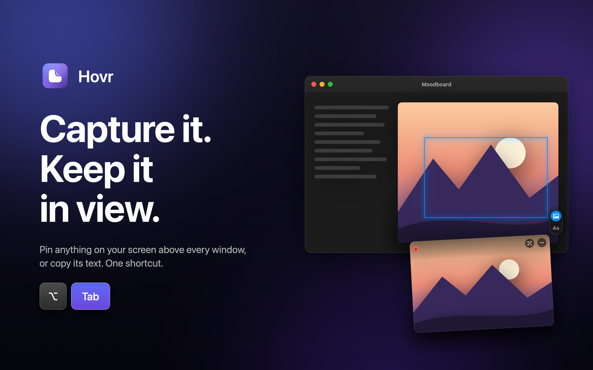
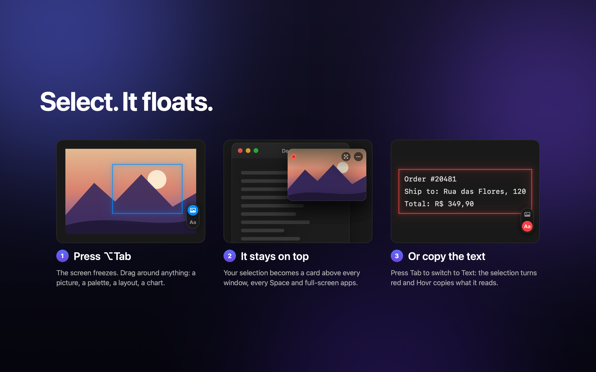
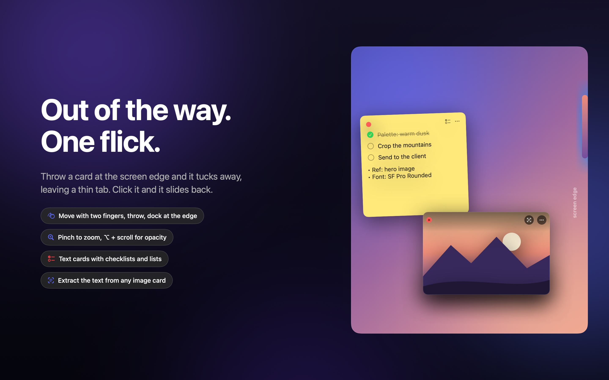
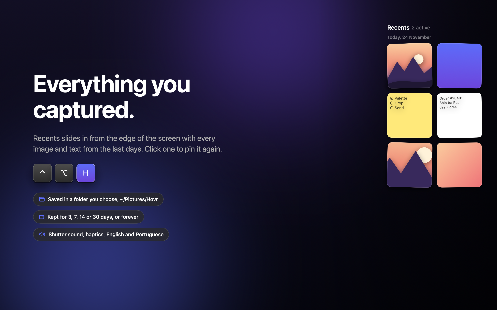

# Hovr

**English** · [Português](README.pt-BR.md)



A menu bar app for visual references. Press **⌥Tab**, select anything on your screen, and it stays floating above every window as a card — or copy its text instead. Everything you capture goes to Recents, a panel that slides in from the edge of the screen.

## Screenshots







## Download

Grab **Hovr.zip** from the [latest release](https://github.com/lucashaliax/Hovr/releases/latest), unzip it and drag `Hovr.app` to `/Applications`.

Hovr isn't notarized by Apple, so macOS blocks it the first time you open it. To allow it:

1. Open Hovr once. macOS will say it can't verify the developer; click **Done**.
2. Go to **System Settings → Privacy & Security**, scroll down and click **Open Anyway** next to Hovr.

Or run this once in Terminal:

```bash
xattr -dr com.apple.quarantine /Applications/Hovr.app
```

Then:

1. Press **⌥Tab**. When macOS asks, allow Hovr in **Screen Recording** (it needs this to capture the area you select), then quit and reopen it.
2. For pinch to zoom on cards, allow Hovr in **Input Monitoring** from **Settings → Advanced** (it only listens to trackpad gestures).

The icon in the menu bar opens Capture, Capture Text, Recents and Settings.

## How to use

| | |
|---|---|
| **⌥Tab** | Freeze the screen and select. Drag an area; ⇧ for a square, hold ⌥ and click corners for a free-form shape, Space for a whole window |
| **Tab** while selecting | Switch between **Image** (blue: pin it as a card and copy it) and **Text** (red: copy the text it reads) |
| **Click without dragging** in Text mode | A new text card (note) right there |
| **⌃⌥H** | Recents |
| **⌃⌥V** | Hide or show every card |

On a card: drag or move with two fingers, flick to throw it, throw it at a screen edge to dock it as a thin tab (click the tab to bring it back), pinch or ⌘ + scroll to zoom, ⌥ + scroll or ⌘1–9 for opacity, ⌘L to lock, ⌘W to close. The ⋯ button has copy, colour, opacity, lock and delete.

## Features

- Captures from every display, with a soft glow and an Image/Text badge that follows the pointer
- Image cards appear right where you selected them, a little bigger, above every window, every Space and full-screen apps
- Extract the text from any image card (on-device OCR with Apple's Vision)
- Text cards with checklists, bullets, numbered lists, bold, italic, underline, strikethrough and text size; 11 colours or a random one
- Dock cards at the screen edge, with a glow that tells you where they'll go
- Recents: every image and text from the last 3, 7, 14 or 30 days (or forever), saved as files in a folder you choose (`~/Pictures/Hovr` by default)
- Shutter and whoosh sounds and trackpad haptics, each can be turned off
- All global shortcuts can be changed
- Updates itself: Check for Updates in About (and an optional weekly automatic check) downloads the latest release, verifies its signature and relaunches
- Open at login, English and Portuguese interface
- Light on resources: about 12–24 MB in memory and 0% CPU while idle

## Requirements

- macOS 14 or later
- Screen Recording permission (Input Monitoring is optional, for pinch to zoom)

## Build from source

Requires Xcode. Open `Hovr.xcodeproj` once and pick your **Team** in *Signing & Capabilities*. Then:

```bash
tools/build.sh          # build (Release), install in /Applications, relaunch, check resource use
tools/build.sh --draft  # build and run from the build folder, without installing
tools/build.sh --zip    # build, install, and write build/release/Hovr.zip for a GitHub release
```

Every build ends with `tools/check_resources.sh`, which measures the running app while idle (memory, CPU, wakeups per second, leaks) and fails on leaks or idle CPU use.

The project file is generated by `tools/gen_project.py` (run it again after adding or removing Swift files; it keeps your Team). Translations: `python3 tools/make_strings.py`. App icon: `cat App/HovrGlyph.swift tools/make_icons.swift > /tmp/hovr_icons.swift && swift /tmp/hovr_icons.swift`.

The promo images are generated in code:

```bash
swiftc -O -swift-version 5 Promo/PromoRenderer.swift -o build/promo-render && build/promo-render
```

---

Developed by Lucas Haliax
