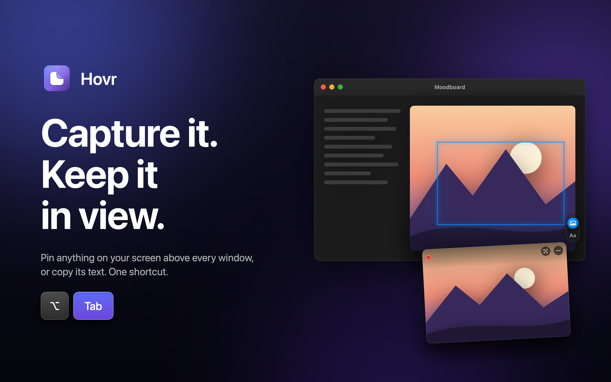
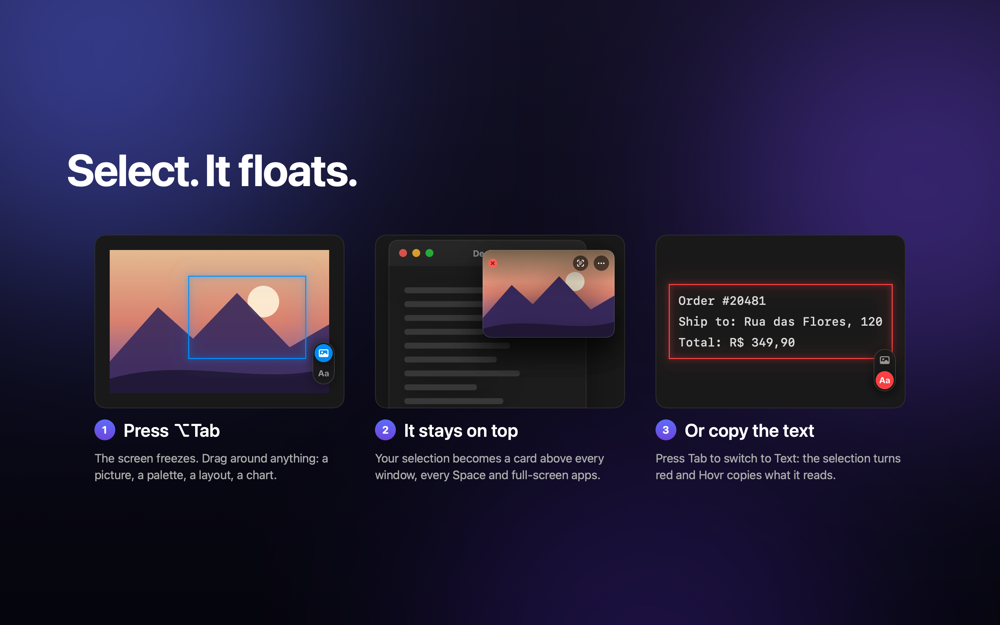
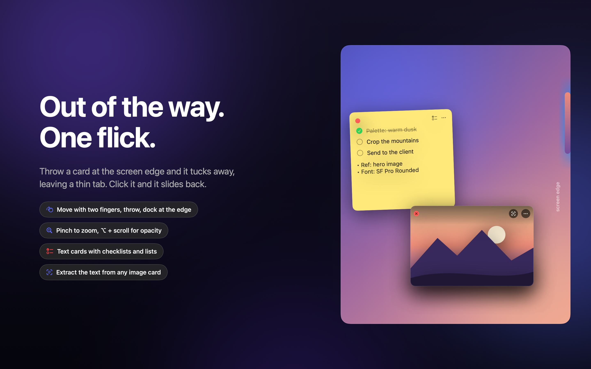
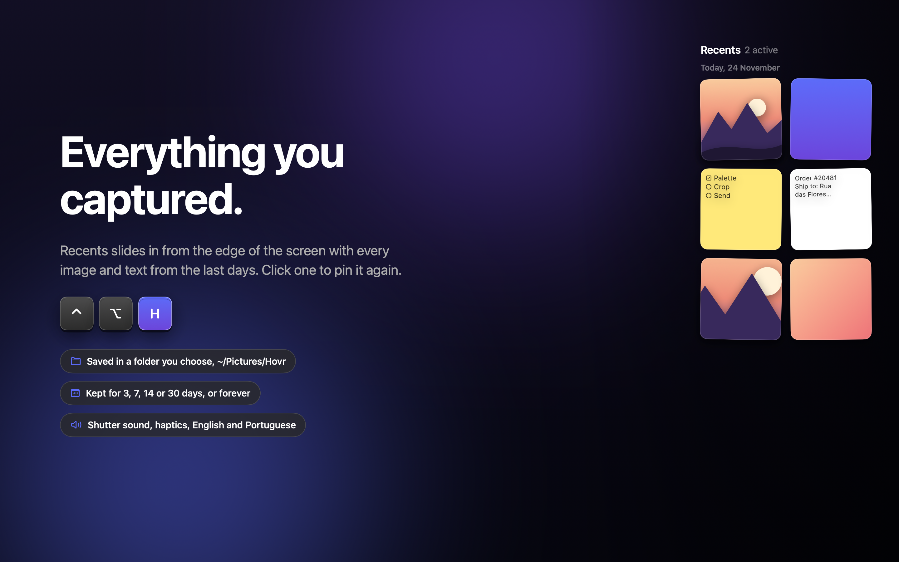

# Hovr

[English](README.md) · **Português**



Um app de barra de menus para referências visuais. Aperte **⌥Tab**, selecione qualquer coisa na tela e ela fica flutuando acima de todas as janelas como um card — ou copie o texto dela. Tudo o que você captura vai para os Recentes, um painel que desliza da borda da tela.

## Screenshots







## Download

Baixe o **Hovr.zip** no [último release](https://github.com/lucashaliax/Hovr/releases/latest), descompacte e arraste o `Hovr.app` para `/Aplicativos`.

O Hovr não é notarizado pela Apple, então o macOS bloqueia a primeira abertura. Para liberar:

1. Abra o Hovr uma vez. O macOS vai dizer que não consegue verificar o desenvolvedor; clique em **OK**.
2. Vá em **Ajustes do Sistema → Privacidade e Segurança**, role até o fim e clique em **Abrir Mesmo Assim** ao lado do Hovr.

Ou rode isto uma vez no Terminal:

```bash
xattr -dr com.apple.quarantine /Applications/Hovr.app
```

Depois:

1. Aperte **⌥Tab**. Quando o macOS pedir, permita o Hovr em **Gravação de Tela** (ele precisa disso para capturar a área que você seleciona) e reabra o app.
2. Para a pinça dar zoom nos cards, permita o Hovr em **Monitoramento de Entrada** pelos **Ajustes → Avançado** (ele só escuta gestos do trackpad).

O idioma padrão é inglês; para usar em português, vá em **General → Language** e escolha **Português**.

## Como usar

| | |
|---|---|
| **⌥Tab** | Congela a tela para selecionar. Arraste uma área; ⇧ para um quadrado, segure ⌥ e clique nos cantos para uma forma livre, Espaço para uma janela inteira |
| **Tab** durante a seleção | Alterna entre **Imagem** (azul: fixa como card e copia) e **Texto** (vermelho: copia o texto que encontrar) |
| **Clique sem arrastar** no modo Texto | Um card de texto (nota) ali mesmo |
| **⌃⌥H** | Recentes |
| **⌃⌥V** | Esconder ou mostrar todos os cards |

Num card: arraste ou mova com dois dedos, dê um peteleco para arremessar, arremesse na borda da tela para encaixar como uma aba fina (clique na aba para voltar), pinça ou ⌘ + rolagem para zoom, ⌥ + rolagem ou ⌘1–9 para opacidade, ⌘L para bloquear, ⌘W para fechar. O botão ⋯ tem copiar, cor, opacidade, bloquear e excluir.

## Recursos

- Captura em todas as telas, com um brilho suave e um indicador Imagem/Texto que segue o cursor
- Os cards de imagem aparecem onde você selecionou, um pouco maiores, acima de todas as janelas, em todos os Spaces e apps em tela cheia
- Extrair o texto de qualquer card de imagem (OCR no próprio Mac, com o Vision da Apple)
- Cards de texto com checklist, marcadores, listas numeradas, negrito, itálico, sublinhado, tachado e tamanho do texto; 11 cores ou uma aleatória
- Encaixar cards na borda da tela, com um brilho que mostra onde eles vão entrar
- Recentes: todas as imagens e textos dos últimos 3, 7, 14 ou 30 dias (ou para sempre), salvos como arquivos numa pasta que você escolhe (`~/Pictures/Hovr` por padrão)
- Sons de obturador e whoosh e resposta tátil no trackpad, cada um pode ser desligado
- Todos os atalhos globais podem ser alterados
- Se atualiza sozinho: Procurar atualizações em Sobre (e uma verificação semanal automática opcional) baixa o último release, verifica a assinatura e reabre
- Abrir ao iniciar a sessão, interface em inglês e português
- Leve: cerca de 12–24 MB de memória e 0% de CPU parado

## Requisitos

- macOS 14 ou posterior
- Permissão de Gravação de Tela (Monitoramento de Entrada é opcional, para a pinça)

## Compilar a partir do código

Precisa do Xcode. Abra o `Hovr.xcodeproj` uma vez e escolha seu **Team** em *Signing & Capabilities*. Depois:

```bash
tools/build.sh          # compila (Release), instala em /Applications, reabre, mede o uso de recursos
tools/build.sh --draft  # compila e roda da pasta de build, sem instalar
tools/build.sh --zip    # compila, instala e gera build/release/Hovr.zip para um release no GitHub
```

Todo build termina com o `tools/check_resources.sh`, que mede o app parado (memória, CPU, despertares por segundo, vazamentos) e falha se houver vazamento ou uso de CPU parado.

O projeto é gerado pelo `tools/gen_project.py` (rode de novo depois de adicionar ou remover arquivos Swift; ele mantém seu Team). Traduções: `python3 tools/make_strings.py`. Ícone do app: `cat App/HovrGlyph.swift tools/make_icons.swift > /tmp/hovr_icons.swift && swift /tmp/hovr_icons.swift`.

As imagens promocionais são geradas em código:

```bash
swiftc -O -swift-version 5 Promo/PromoRenderer.swift -o build/promo-render && build/promo-render
```

---

Desenvolvido por Lucas Haliax
